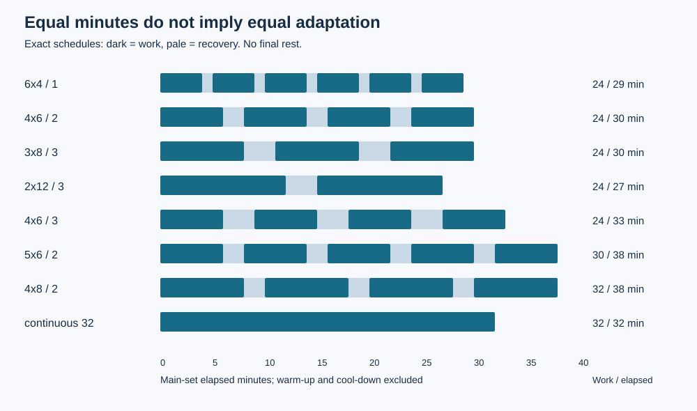

# Androgens, Estradiol and Subthreshold Endurance Adaptation

## An evidence audit and reproducible framework for jump-rope and hybrid training

**Critical narrative review and methods paper | Version 1.0 | 16 November 2026**

Prepared for Peter Kosanyi. Literature synthesis, writing and computational auditing assisted by OpenAI Codex. This report does not claim academic affiliation, clinical credentials, peer review or a new human experiment.

## Abstract

**Background.** An incomplete analysis attributed superior aerobic adaptation at testosterone concentrations of 2,000-3,000 ng/dL to enhanced recovery and erythropoiesis, while treating estradiol of 30 pg/mL as a glucose-transport and microvascular bottleneck. It then asserted an optimal interval prescription without measured physiology or fitted coefficients.

**Objective.** Determine which endocrine and exercise claims survive an evidence audit, and construct a reproducible quantitative framework consistent with a preference for subthreshold training rather than maximal intervals.

**Methods.** Targeted searches of indexed human studies, original journal reports and endocrine guidance were conducted on 16 November 2026. A critical narrative synthesis assessed population, exposure, endpoint and transferability. Deterministic calculations compared session timing, reconstructed the starting score, and explored an explicitly hypothetical first-order response model. No individual observations or intervention data were collected.

**Results.** Controlled research establishes androgen effects on lean mass and hemoglobin, but does not identify the aerobic adaptation difference between the stated testosterone concentrations in trained male hybrid athletes. Estradiol of 30 pg/mL alone does not establish estrogen deficiency, impaired GLUT4 function or an optimal rest duration. The starting score does not optimize session time, contains no fitted hormonal terms, and selects 8-minute bouts with 4-minute rests on its own discrete grid rather than the asserted fixed 3-minute rest. Exact scheduling shows that 4 x 6 minutes with 2-minute rests requires 30 minutes, whereas 4 x 8 minutes with 2-minute rests requires 38 minutes. Neither calculation predicts adaptation.

**Conclusion.** A hormone-specific optimum is not identifiable from the available inputs. A defensible replacement uses measured, modality-specific intensity; separates local mechanical tolerance from systemic aerobic demand; compares matched workloads; and evaluates longitudinal adaptation independently of acute proxies.

**Keywords:** testosterone; estradiol; critical power; oxygen uptake kinetics; subthreshold intervals; jump rope; HYROX; identifiability.

## 1. Research question and scope

The relevant question is whether changing bout length, recovery duration or session distribution improves aerobic adaptation when an athlete prefers repeatable work below an individually determined upper threshold. The scenario involves roughly seven weekly training hours, repeated jump-rope or high-knee bouts lasting approximately 3-8 minutes, and hybrid-event conditioning. It does not require a discussion centered on maximal strength, aggression or all-out exercise.

Three distinct outcomes must be kept separate: maximal aerobic capacity, sustainable submaximal performance, and performance in a mixed running-and-station event. An intervention can change one without improving the others. A faster submaximal pace may reflect economy or threshold changes without a higher measured VO2max. A better hybrid-event time also depends on transitions, technique, pacing and local muscular endurance. The present paper therefore treats VO2peak, modality-specific threshold performance, and a standardized hybrid benchmark as separate endpoints.

The hormonal concentrations are hypothetical exposure scenarios, not verified personal laboratory results. This paper does not recommend attaining them. It asks what can be inferred if such concentrations are assumed. The comparison is causal: how would the same athlete adapt under otherwise comparable conditions? A single laboratory panel cannot answer that counterfactual.

## 2. Review methods and evidence hierarchy

Targeted web searches used combinations of testosterone, dose response, aerobic performance, erythropoietin, hepcidin, estradiol, GLUT4, critical power, threshold intervals, oxygen kinetics and glycogen recovery. PubMed records, accessible original reports and professional-society guidance were prioritized. Searches emphasized human interventions and physiological experiments; reviews were used for definitions and context and are labeled as such. Selected records were checked by title, year and DOI or PMID. Some results were available only as indexed abstracts; no inaccessible tables were reconstructed.

This is a critical narrative review, not a systematic review or meta-analysis. There was no preregistered search, duplicate screening, exhaustive database export or formal risk-of-bias scoring. Absence of an identified matching trial is an evidence gap in this review, not proof that no such study exists. Search terms, source-access levels and computational assumptions are recorded in METHODS.md, references.json and evidence.csv.

The hierarchy is claim-specific. Randomized human data support effects within the studied population and exposure. Mechanistic data establish pathways without fixing a training optimum. Cross-population findings require explicit qualification. Arithmetic follows from stated definitions. Simulated response curves are assumption-dependent demonstrations, with no status as observed adaptation.

## 3. Endocrine claims: what the evidence establishes

### 3.1 Testosterone, exposure and the missing endurance function

In a 20-week dose-response experiment, Bhasin and colleagues randomized 61 men aged 18-35 after endogenous suppression. Mean nadir testosterone in the highest-exposure group was approximately 2,370 ng/dL. Lean mass and hemoglobin increased with exposure; fat-free mass rose by 7.9 kg in that group. These are substantial biological effects. The experiment did not measure the proposed jump-rope, critical-power or HYROX adaptation outcomes. Its group mean is not a conversion rule from a single serum result to performance. [1]

Bachman and colleagues studied older men with mobility limitations over six months. Their results implicated increased erythropoietin and suppressed hepcidin in testosterone-associated erythropoiesis. They support a blood-production mechanism, not a statement that a particular athlete must have high hematocrit at a specified testosterone concentration. Hemoglobin, hematocrit and iron indices remain measurements to obtain, not values to impute. [2]

The direct exercise evidence is population-dependent. In an 80-participant trial of men aged 50-70 with low-normal testosterone, exercise improved VO2peak, whereas testosterone treatment did not confer an additional aerobic benefit. This does not test supraphysiological exposure in young trained men, but it demonstrates why lean-mass effects cannot automatically be translated into aerobic-training effects. [4]

A randomized trial in 48 physically active young women found an improvement in running time to exhaustion after a moderate increase in testosterone. The reported 8.5% within-group increase is not an 8.5% improvement in VO2max or race time, and neither the population nor exposure matches the present male scenario. This positive endurance-related finding is relevant evidence, but provides no interpolation between 2,000, 2,500 and 3,000 ng/dL in men. [5]

| Hypothetical testosterone | Approximate SI value | Aerobic adaptation versus 600-700 ng/dL |
| --- | --- | --- |
| 600-700 ng/dL | 20.8-24.3 nmol/L | Reference scenario; individual physiology unmeasured |
| 2,000 ng/dL | 69.3 nmol/L | Magnitude and net performance effect not identified |
| 2,500 ng/dL | 86.7 nmol/L | Increment over 2,000 ng/dL not identified |
| 3,000 ng/dL | 104.0 nmol/L | Increment over 2,500 ng/dL not identified |

Conversion: testosterone in ng/dL multiplied by 0.03467 gives nmol/L. All scenarios above 2,000 ng/dL are markedly supraphysiological; this table ranks no regimen and estimates no benefit. The earlier use of g/dL instead of ng/dL was a billion-fold unit error.

### 3.2 Estradiol of 30 pg/mL is not an established bottleneck

Finkelstein and colleagues separated androgen and estrogen effects in two cohorts totaling 400 healthy men, using gonadal suppression with differing testosterone exposure and aromatase inhibition in one cohort. Outcomes included body composition, strength and sexual function, not aerobic adaptation. Baseline estradiol group means were approximately 27-32 pg/mL. Consequently, 30 pg/mL cannot simply be labeled deficient because testosterone is high. This does not establish that 30 pg/mL is optimal for every individual either. [3]

A testosterone-to-estradiol ratio is also unit-dependent: testosterone at 3,000 ng/dL is 30,000 pg/mL, so a mass-concentration ratio to 30 pg/mL is 1,000, not 100. Converting both analytes to molar units changes the numerical ratio again. Neither representation supplies a validated endurance threshold. A changing denominator or numerator does not identify tissue receptor signaling.

The scenario attributes the estradiol value to low aromatization; artificial suppression should not be assumed. More fundamentally, one serum result does not measure aromatase activity, tissue estrogen availability, vascular conductance or skeletal-muscle glucose flux. Estradiol assays also have important precision and method-comparison limitations at low concentrations. Interpretation requires the assay, sampling conditions and clinical context. [15]

Human muscle experiments demonstrate exercise-associated GLUT4 translocation. That pathway is not adequately represented by a model in which serum estradiol alone controls glucose entry into working muscle. Thorell and colleagues observed increased plasma-membrane GLUT4 after exercise and insulin stimulation in nine volunteers. The experiment does not test the proposed high-testosterone scenario; it does refute the premise that the whole transport problem can be reduced to an assumed estradiol penalty. [6]

There is therefore no basis here for assigning a percentage loss of fuel efficiency, declaring calf fatigue a hormonal symptom, or lengthening rest from two to three minutes on the basis of estradiol alone.

### 3.3 Oxygen content is one term in oxygen transport

The organizing identity is the Fick relation: VO2 = cardiac output x (arterial oxygen content - venous oxygen content). In common units, arterial oxygen content is approximated by 1.34 x hemoglobin x arterial saturation + 0.003 x arterial oxygen pressure, yielding mL O2/dL when hemoglobin is g/dL and pressure is mmHg. Multiplication by cardiac output in L/min requires the conversion factor 10 dL/L to obtain oxygen uptake in mL/min.

Holding saturation fixed, more hemoglobin increases oxygen content per volume of blood. It does not establish cardiac output, muscle extraction, economy, body mass or the longitudinal training response. Hematocrit is a concentration affected by plasma volume, not a direct measure of total hemoglobin mass. Neither improved oxygen transport nor impaired microcirculation can be calculated from testosterone alone. These equations organize measurements; they are not the performance model missing from the starting analysis.

## 4. Correct exercise physiology for the stated training preference

### 4.1 Threshold is a measurement, not a transferable dashboard percentage

Critical power (CP), maximal lactate steady state, ventilatory thresholds and functional threshold power (FTP) are related constructs with different methods and uncertainty. CP characterizes the power-duration relation and the boundary between heavy and severe exercise. It is not a promise of literally indefinite exercise: fuel availability, temperature and other constraints still limit duration. For work above CP, the simple relation P = CP + W-prime/t describes a finite-work model within its valid testing range. [12]

In 17 trained cyclists and triathletes, Karsten and colleagues found strong correlation between CP and a 20-minute FTP estimate but limits of agreement of approximately -19 to +33 W. Group correlation did not justify using the estimates interchangeably in an individual. [9]

For jump rope, cadence is not mechanical power. Jump height, body mass, contact mechanics and rope technique change the demand at the same cadence. High knees have similar standardization problems. Consequently, 88% of cycling FTP, 88% of heart-rate maximum and a rope cadence described as sweet spot are not equivalent prescriptions. Each modality requires its own operational anchor.

Below-threshold work can still involve glycolytic ATP production and lactate turnover. The distinction is not a binary switch between aerobic and anaerobic metabolism. Lactate is produced and used under oxygenated conditions and participates in fuel exchange; it is not an inert structural waste requiring a special flushing interval. [16]

### 4.2 Local fatigue and whole-body demand are different constraints

Breathing that remains controlled while the calves progressively fatigue does not identify a hormonal defect. It is compatible with a local mechanical or muscular limitation, but observations of technique, loading history and symptoms are needed to distinguish explanations. A heart-rate target can be met while local tissue demand is excessive for repeatable training. Conversely, lowering impact through another modality may permit more systemic aerobic work without solving sport-specific tolerance.

This distinction changes the optimization problem. Increasing the length of a rope interval may increase uninterrupted aerobic demand while reducing the quality of later repetitions. Shortening the interval may protect technique while increasing recovery time. The value of either choice must be measured against the outcome and time budget, rather than inferred from an endocrine narrative.

### 4.3 Recovery processes have different timescales

Brief between-bout recovery changes oxygen uptake, cardiorespiratory strain and local fatigue. It should not be described as fully replenishing muscle glycogen. A randomized crossover experiment in eight men tracked glycogen recovery over 24 hours under different carbohydrate intakes, illustrating that restoration depends on recovery duration and nutrition. It did not test high-testosterone rope training or demonstrate a universal 40-minute depletion boundary. [7]

The broader glycogen literature distinguishes early recovery over hours from later recovery across the day. It does not support near-instant structural repair or a hormone-driven metabolic reset between two sessions. Splitting a session may help convenience or mechanical tolerance, but also creates a second warm-up and does not guarantee better adaptation for equal weekly work. [18]

### 4.4 What interval studies can and cannot transfer

Seiler and colleagues randomized 35 recreational cyclists to seven weeks of training. The 4 x 8-minute group improved selected aerobic outcomes more than the comparison groups. However, sessions were prescribed at maximal tolerable intensity; reported lactate in the 4 x 8 group was about 9.6 mmol/L. It would be incorrect to cite this as proof that 4 x 8 at the present scenario's subthreshold intensity is optimal. Duration and intensity interacted in that experiment. [11]

Fleckenstein and colleagues studied 15 trained runners during 40 minutes at an individually derived fixed-lactate workload. Internal responses varied substantially: endpoint lactate ranged from 1.90 to 3.80 mmol/L and perceived exertion from 3 to 10. A nominal common threshold anchor therefore did not produce uniform acute strain. [10]

Lactate-guided threshold training has a coherent practical rationale, but descriptions of successful elite programs do not establish causality or transfer directly to a seven-hour week with repetitive jumping. The published account of that model is a descriptive review, not a randomized proof of double-threshold superiority. [17]

## 5. Quantitative audit of the starting model

The starting prose introduced named coefficients for stimulus decay, vascular clearance and central androgen buffering without specifying measurements, units, parameter estimation or a validation dataset. A code block visible in the originating analysis supplies a more concrete, but still unvalidated, score. Reconstructing that expression with work duration w and rest r in minutes gives:

**S(w,r) = 0.88 w exp[-0.05 max(w - 3, 0)] - max{0, 0.15 w - 0.25[1 - exp(-0.4 r)]}.**

The constants are assumptions, not fitted endocrine parameters. Testosterone and estradiol are mentioned in comments but do not appear as variable inputs. Intensity is held fixed, so the search cannot discover an optimal intensity. There is no session-count term, weekly-load term, tissue state carried between repetitions, or mapping to change in VO2peak.

Where the fatigue expression is positive, the derivative with respect to rest is 0.1 exp(-0.4 r), which is positive. Longer rest therefore always improves this per-bout score until its penalty reaches zero; elapsed time is never charged. The formula cannot identify a special three-minute optimum. On the stated grid w = {3,4,6,8} and r = {1.5,2,3,4}, its maximum is w = 8 and r = 4. The calculated score is an arbitrary number, not measured adaptation.

Dividing by w + r would create a different objective and could change the ranking, but would not validate the coefficients. Likewise, a larger simulation or finer search would optimize the assumptions more precisely without establishing their physiology. The appropriate correction is to identify observable endpoints before fitting an objective.

## 6. Replacement calculations: exact schedules and explicit uncertainty

### 6.1 Time accounting

For n repetitions, work duration w and between-bout recovery r, main-set duration is n w + (n - 1) r. There is no final recovery in that definition. Add warm-up and cool-down separately. The following values are exact arithmetic.

| Protocol: repetitions x work / rest | Work, min | Main set, min | Work density | With 15 min warm-up/cool-down |
| --- | --- | --- | --- | --- |
| 6 x 4 / 1 min | 24 | 29 | 82.8% | 44 min |
| 4 x 6 / 2 min | 24 | 30 | 80.0% | 45 min |
| 3 x 8 / 3 min | 24 | 30 | 80.0% | 45 min |
| 2 x 12 / 3 min | 24 | 27 | 88.9% | 42 min |
| 4 x 6 / 3 min | 24 | 33 | 72.7% | 48 min |
| 5 x 6 / 2 min | 30 | 38 | 78.9% | 53 min |
| 4 x 8 / 2 min | 32 | 38 | 84.2% | 53 min |
| Continuous 32 min | 32 | 32 | 100.0% | 47 min |

A 40-minute whole session is a different constraint from a 40-minute interval block. With a 10-minute warm-up and 5-minute cool-down, only 25 minutes remain for the main set. For example, 4 x 5 minutes with 90-second rests occupies 24.5 minutes and totals 39.5 minutes. These timings correct the ambiguity without selecting a physiological winner.

### 6.2 A kinetic illustration, not an adaptation predictor

A first-order response can illustrate onset and recovery: dq/dt = (q-target - q)/tau. Its exact solution over duration d is q-end = q-target + (q-start - q-target) exp(-d/tau). The integrated response is q-target d + (q-start - q-target) tau [1 - exp(-d/tau)]. This integral has response-time units, not units of improvement.

The demonstration assumes dimensionless work target 0.88, recovery target and initial state 0.35, and time constants of 30, 60 and 90 seconds. These values are hypothetical; 0.88 is not 88% of FTP, CP, heart-rate maximum or measured VO2max. The code integrates only work periods, with the state continuing through recovery. All durations are converted to seconds internally.

Human experiments support approximately exponential primary kinetics in moderate exercise, while heavier work can require more complex models. Applying a single time constant to subthreshold rope work is therefore a deliberate simplification, not a fitted representation of that athlete. [8]

The following work-period means are outputs of those assumptions, rounded to three decimals. They are dimensionless response values, not measured oxygen uptake, adaptation scores or percentages of capacity.

| Protocol | Assumed tau 30 s | Assumed tau 60 s | Assumed tau 90 s |
| --- | --- | --- | --- |
| 4 x 6 / 2 min | 0.836 | 0.801 | 0.775 |
| 3 x 8 / 3 min | 0.847 | 0.816 | 0.790 |
| 4 x 6 / 3 min | 0.836 | 0.795 | 0.763 |
| Continuous 32 min | 0.872 | 0.863 | 0.855 |

This model demonstrates that repeated onsets reduce the average modeled response during work and that longer rests permit more decline before restarting. It contains no slow component, cardiovascular drift, local fatigue, tissue loading, glycogen dynamics or training adaptation. A continuous session may score well precisely because those constraints were omitted. The model cannot convert time at an elevated response into a percentage change in VO2peak.

### 6.3 Break-even analysis is more defensible than a false optimum

Consider 5 x 6 / 2 and 4 x 8 / 2: both occupy 38 main-set minutes, with 30 and 32 work minutes respectively. Define a purely illustrative retained-quality factor Q between zero and one. A work-weighted proxy is work minutes x Q, assuming the same external intensity. This factor is not a validated composite of cadence, economy or adaptation.

The 32-minute option exceeds the 30-minute option only if 32 Q-long > 30 Q-short. If Q-short = 1, break-even Q-long = 30/32 = 0.9375. At 95% retained quality, the longer option supplies 30.4 weighted minutes; at 90%, it supplies 28.8. The ranking changes without any hormone term.

The useful result is a question: does the extra work preserve output, technique and recovery sufficiently to justify it? Even a favorable answer would establish acute feasibility rather than greater long-term adaptation. Measurement should replace the assumed Q before making a decision.

## 7. A testable training decision framework

The appropriate objective is improvement in a specified performance endpoint over a defined period, subject to a weekly time budget, a subthreshold intensity ceiling and acceptable local tolerance. Acute work minutes and response integrals are candidate explanatory variables, not the endpoint itself.

For an already trained, medically appropriate participant, 4 x 6 / 2 can serve as an experimental starting comparison because it supplies 24 work minutes with manageable accounting. It has no privileged hormonal status. Comparing it with 3 x 8 / 3 holds work and total main-set time constant while changing bout duration. Comparing 4 x 6 / 2 with 4 x 6 / 3 isolates added recovery time at the cost of three extra minutes. These are design choices, not validated prescriptions.

Intensity should be anchored within each modality using an appropriately assessed threshold and observed repeatability. For rope work, fix technique, rope, surface, footwear, cadence range and an approximate jump-height criterion. Record cadence and missed jumps together with internal strain. Heart rate and perceived exertion are useful context but do not independently certify that every repetition remains below the physiological boundary. An individualized lactate assessment, if available, adds information without making a universal fixed lactate concentration correct for everyone. [10]

If local fatigue degrades mechanics before systemic aerobic demand is reached, shortening bouts or substituting part of the aerobic volume with a lower-impact modality is a candidate intervention. Maintain separate records of aerobic minutes and jumping exposure. A sustainable seven-hour week need not be seven hours of threshold work or seven hours of repetitive impacts.

Session splitting should be evaluated at matched weekly work, intensity, nutrition and total elapsed time. A second warm-up consumes part of a fixed budget. For example, two 33-minute main sets with 15 minutes of surrounding work each total 96 minutes, not 70. Any comparison that adds training time or work and attributes the result to splitting alone is confounded.

## 8. Proposed validation study

### 8.1 Acute feasibility phase

Use repeated, randomized crossover comparisons of matched-work interval structures. Familiarize participants before collection. Standardize time of day, previous training, environmental conditions, footwear, surface and pre-session nutrition as far as feasible. Include sufficient recovery between test days to return to the predefined baseline readiness criterion; do not assume a hormone-dependent recovery interval.

Prespecify completion at target output as the primary feasibility endpoint. Record repetition-level external output, heart rate, whole-body exertion, local calf exertion, technique deviations and next-day local symptoms. If laboratory resources permit, collect breath-by-breath gas exchange and repeated lactate measures using the same protocol across conditions. The acute phase can identify tolerability and response patterns, not chronic superiority.

### 8.2 Longitudinal adaptation phase

A parallel-group study over approximately 8-12 weeks is preferable to interpreting a short crossover as a training experiment, because acquired fitness carries into subsequent periods. Match weekly time and the rest of the hybrid program; report completed work as well as prescribed work. Randomization, blinded outcome assessment where feasible and an analysis plan should precede data collection.

Select one primary endpoint, such as change in laboratory-measured VO2peak, and secondary endpoints such as threshold speed or power, standardized fixed-output physiological cost, and a reproducible hybrid benchmark. Repeated baseline tests estimate test-retest error. Report baseline-adjusted group differences with confidence intervals and adherence. Do not interpret an isolated within-group significant change as proof of a between-group effect.

No hormone manipulation is required or proposed. If endocrine measures are collected in an ethically approved study, treat exposure as observational unless randomized by an appropriate clinical design. Associations with training response remain susceptible to confounding by baseline fitness, body composition, nutrition, illness and other exposures. A single person's response cannot identify a population hormone dose-response curve.

### 8.3 Identifiability and sample-size discipline

Let the target be adaptation = f(training, baseline state, recovery, nutrition, endocrine exposure and unobserved factors). Serum testosterone and estradiol supply only two inputs to an unknown multivariable function. Without repeated outcomes or appropriate intervention contrasts, many different functions fit the same input values and imply different optima. This is an identifiability problem, not merely a need for a more elaborate equation.

Do not select sample size from the illustrative response model. Use a prespecified meaningful between-group difference and variability from relevant test-retest or pilot observations; account for dropout and multiplicity. Numerical sensitivity to assumed coefficients is not a confidence interval. A future adaptation model would require longitudinal fitting, held-out validation and calibration checks before being used prospectively.

## 9. Clinical boundary and competing risks

Endocrine Society guidance addresses clinically diagnosed hypogonadism and emphasizes accurate testing and monitoring. It does not validate supraphysiological performance targets. The guideline treats treatment-associated erythrocytosis as clinically important; its 54% hematocrit intervention threshold is a clinical management boundary, not a safe training target or evidence that all lower values are harmless. [13]

In the prospective HAARLEM echocardiography substudy, 31 men were assessed around self-administered anabolic-androgenic steroid exposure. Cardiac structure and function changed during use, with recovery of measured parameters at follow-up in that cohort. The design involved mixed exposures and cannot assign a testosterone-concentration-specific risk or guarantee recovery in another individual. It is evidence that cardiovascular effects can compete with a simplistic oxygen-carriage benefit. [14]

Persistent or worsening calf pain should not be relabeled productive metabolic waste on the basis of serum hormones. Chest pain, fainting, disproportionate breathlessness or new unilateral calf swelling warrant prompt medical assessment rather than changes to an interval equation. This report supplies no dosing, estradiol manipulation, or self-treatment protocol.

## 10. Conclusions

Androgens can change muscle and hematological biology, but those effects do not determine the best interval architecture for subthreshold hybrid training. Estradiol of 30 pg/mL does not establish the metabolic defect assumed by the starting analysis. Critical power is not unlimited endurance, below-threshold exercise is not metabolically pure, and brief rests are not a full glycogen reset.

The original numerical optimum fails both evidential and computational scrutiny. Its constants were uncalibrated, intensity was fixed, session time was omitted and its stated rest recommendation disagreed with its own grid search. The replacement provides exact schedules, an explicitly hypothetical kinetic illustration, and a break-even calculation that makes the missing measurements visible.

For the stated objective, the defensible research program is to measure modality-specific intensity and local tolerance, compare matched workloads, and test adaptation over time. No quantified aerobic advantage between testosterone concentrations of 2,000, 2,500 and 3,000 ng/dL, and no unique work-rest optimum, can be responsibly reported from the present evidence and inputs.

## References

[1] Bhasin S, et al. Testosterone dose-response relationships in healthy young men. *Am J Physiol Endocrinol Metab.* 2001;281:E1172-E1181. https://doi.org/10.1152/ajpendo.2001.281.6.E1172

[2] Bachman E, et al. Testosterone induces erythrocytosis via increased erythropoietin and suppressed hepcidin: evidence for a new erythropoietin/hemoglobin set point. *J Gerontol A.* 2014;69:725-735. https://doi.org/10.1093/gerona/glt154

[3] Finkelstein JS, et al. Gonadal steroids and body composition, strength, and sexual function in men. *N Engl J Med.* 2013;369:1011-1022. https://doi.org/10.1056/NEJMoa1206168

[4] Chasland LC, et al. Testosterone and exercise: effects on fitness, body composition, and strength in middle-to-older aged men with low-normal serum testosterone levels. *Am J Physiol Heart Circ Physiol.* 2021;320:H1985-H1998. https://doi.org/10.1152/ajpheart.00010.2021

[5] Hirschberg AL, et al. Effects of moderately increased testosterone concentration on physical performance in young women: a double blind, randomised, placebo controlled study. *Br J Sports Med.* 2020;54:599-604. https://doi.org/10.1136/bjsports-2018-100525

[6] Thorell A, et al. Exercise and insulin cause GLUT-4 translocation in human skeletal muscle. *Am J Physiol.* 1999;277:E733-E741. https://doi.org/10.1152/ajpendo.1999.277.4.E733

[7] Namma-Motonaga K, et al. Effect of different carbohydrate intakes within 24 hours after glycogen depletion on muscle glycogen recovery in Japanese endurance athletes. *Nutrients.* 2022;14:1320. https://doi.org/10.3390/nu14071320

[8] Ozyener F, et al. Influence of exercise intensity on the on- and off-transient kinetics of pulmonary oxygen uptake in humans. *J Physiol.* 2001;533:891-902. https://doi.org/10.1111/j.1469-7793.2001.t01-1-00891.x

[9] Karsten B, et al. Relationship between the critical power test and a 20-min functional threshold power test in cycling. *Front Physiol.* 2021;11:613151. https://doi.org/10.3389/fphys.2020.613151

[10] Fleckenstein D, et al. From incremental test to continuous running at fixed lactate thresholds: individual responses on %VO2max, %HRmax, lactate accumulation, and RPE. *Sports.* 2023;11:198. https://doi.org/10.3390/sports11100198

[11] Seiler S, et al. Adaptations to aerobic interval training: interactive effects of exercise intensity and total work duration. *Scand J Med Sci Sports.* 2013;23:74-83. https://doi.org/10.1111/j.1600-0838.2011.01351.x

[12] Poole DC, et al. Critical power: an important fatigue threshold in exercise physiology. *Med Sci Sports Exerc.* 2016;48:2320-2334. Review. https://doi.org/10.1249/MSS.0000000000000939

[13] Bhasin S, et al. Testosterone therapy in men with hypogonadism: an Endocrine Society clinical practice guideline. *J Clin Endocrinol Metab.* 2018;103:1715-1744. https://doi.org/10.1210/jc.2018-00229

[14] Smit DL, et al. Anabolic androgenic steroids induce reversible left ventricular hypertrophy and cardiac dysfunction: echocardiography results of the HAARLEM study. *Front Reprod Health.* 2021;3:732318. https://doi.org/10.3389/frph.2021.732318

[15] Rosner W, et al. Challenges to the measurement of estradiol: an Endocrine Society position statement. *J Clin Endocrinol Metab.* 2013;98:1376-1387. https://doi.org/10.1210/jc.2012-3780

[16] Brooks GA. Cell-cell and intracellular lactate shuttles. *J Physiol.* 2009;587:5591-5600. Review. https://doi.org/10.1113/jphysiol.2009.178350

[17] Casado A, et al. Does lactate-guided threshold interval training within a high-volume low-intensity approach represent the next step in the evolution of distance running training? *Int J Environ Res Public Health.* 2023;20:3782. Descriptive review. https://doi.org/10.3390/ijerph20053782

[18] Burke LM, van Loon LJC, Hawley JA. Postexercise muscle glycogen resynthesis in humans. *J Appl Physiol.* 2017;122:1055-1067. Review. https://doi.org/10.1152/japplphysiol.00860.2016
